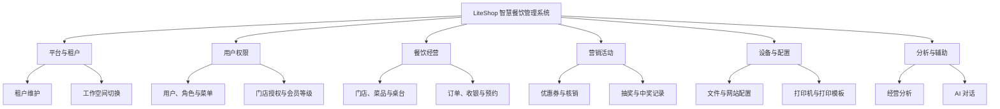
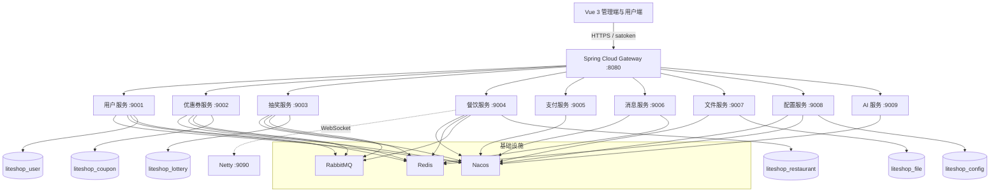
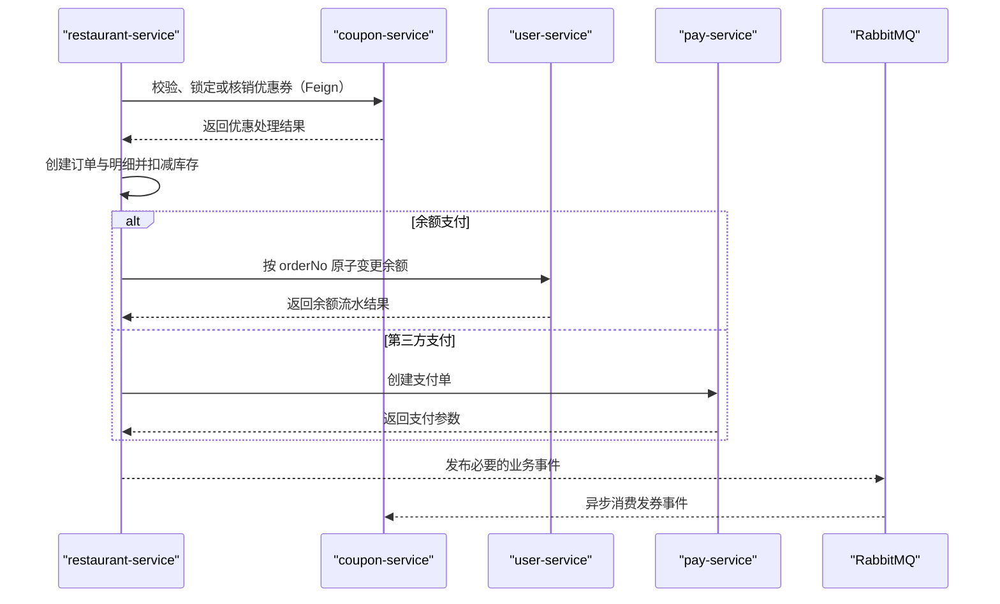
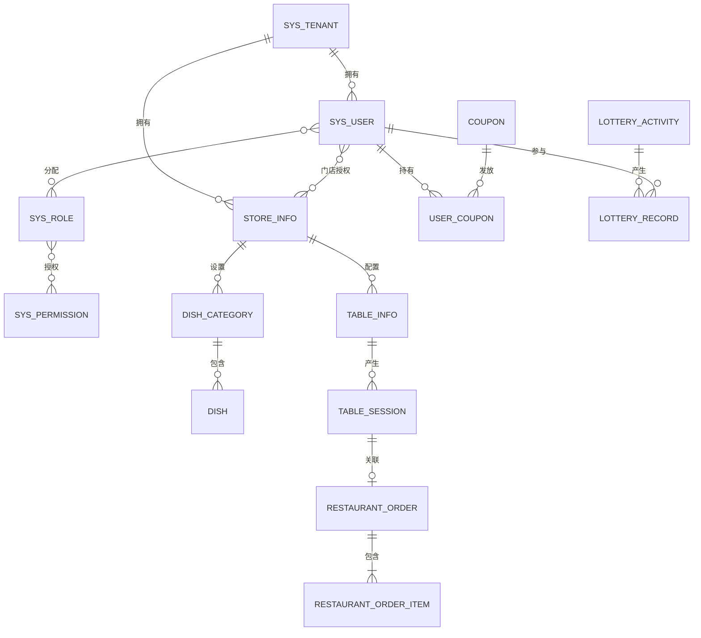
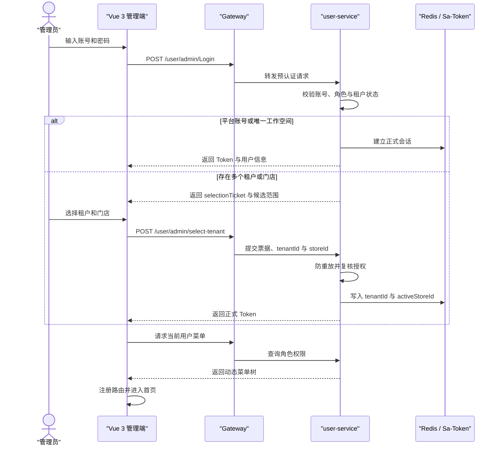
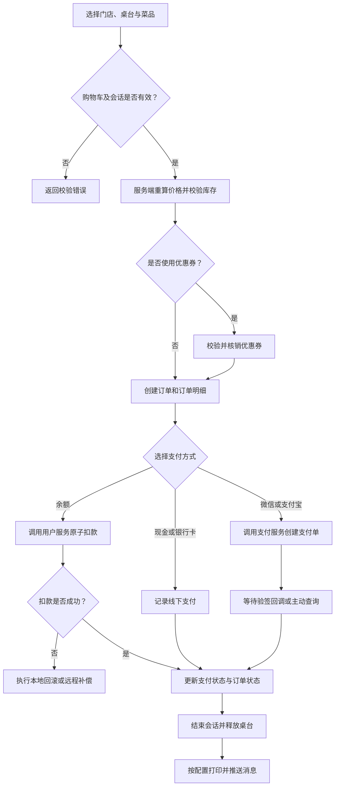
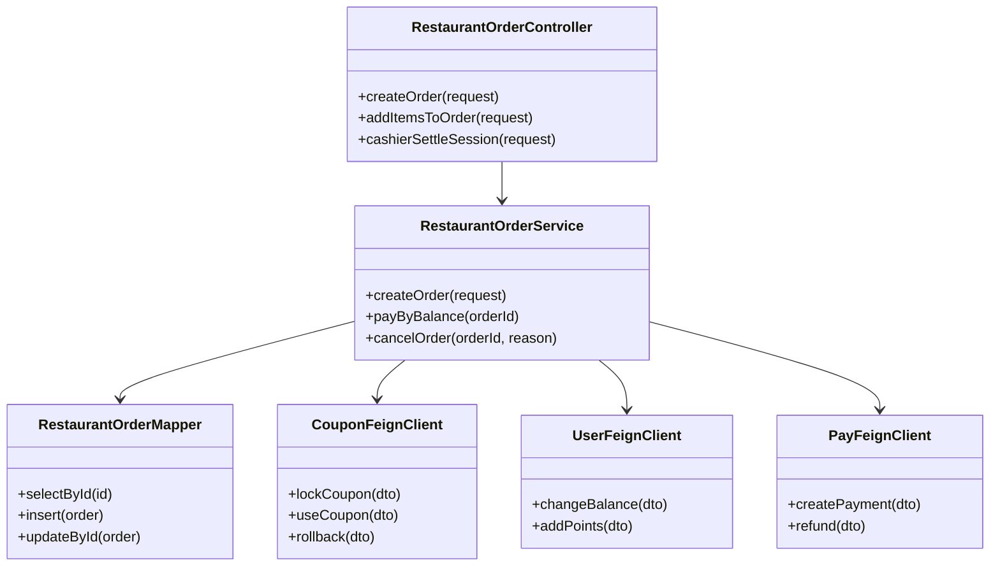

# 基于 Spring Cloud 与 Vue 3 的 LiteShop 智慧餐饮管理系统设计与实现

## 毕业设计（论文）

**学校：**（填写学校名称）  
**学院：**（填写学院名称）  
**专业：**（填写专业名称）  
**学生姓名：**（填写姓名）  
**学号：**（填写学号）  
**指导教师：**（填写教师姓名及职称）  
**完成日期：**（填写年月）

> 说明：本文依据 LiteShop 后端仓库 `liteShop_admin_miniSer` 与管理前端仓库 `liteS` 的源码、配置、SQL 和项目验证文档编写。封面字段、页码、页眉、学校格式及声明页请按所在学校模板补充。

# 摘要

随着餐饮门店由单店经营向连锁化、数字化和精细化运营发展，传统依赖人工记录、单机收银和分散表格的管理方式，在多门店权限隔离、订单协同、营销活动、数据分析以及系统扩展方面逐渐暴露出不足。本文设计并实现 LiteShop 智慧餐饮管理系统。系统以“平台—租户—门店—业务数据”为管理层级，面向平台运营人员、商户管理员、门店管理员、门店员工和消费者提供差异化能力，在统一管理入口下覆盖用户与权限、门店、菜品、桌台、订单、收银、优惠券、抽奖、打印配置、网站配置、文件和经营分析等业务。

后端采用 Java 21、Spring Boot 4.0.7 与 Spring Cloud 2025.1.2 构建微服务体系，借助 Spring Cloud Alibaba 与 Nacos 完成服务发现和配置接入，以 Spring Cloud Gateway 提供统一入口，以 OpenFeign 组织服务间同步调用，以 RabbitMQ 和 Redis 支撑异步事件、缓存及会话等场景；数据访问采用 MyBatis-Plus 3.5.17，认证与授权采用 Sa-Token 1.46.0。根 Maven 工程当前聚合 14 个模块，其中包含 4 个基础模块、1 个网关模块和 9 个业务服务，形成 10 个可执行应用。数据按用户、餐饮、优惠券、抽奖、文件和配置六个数据库进行垂直划分，并通过租户字段和门店范围实现行级隔离。

管理前端采用 Vue 3.5.21、TypeScript 5.6、Vite 8.2.2、Element Plus 2.11.2 与 Pinia 3.0.3，使用动态菜单生成路由，利用请求拦截、无损 JSON 解析和会话版本控制处理认证、超长标识以及工作空间切换。本文从需求、总体架构、数据库、详细设计、前后端实现和测试等方面展开说明。源码中共核实到 27 个后端测试类；项目验证记录显示，曾累计执行 43 项后端测试、10 项前端测试，完成 277 个后端端点与 200 处前端调用的契约审计，并开展 8 组真实联调场景。上述数据属于已有项目记录，并非本文撰写期间重新运行的结果。当前短信和邮件真实投递、第三方支付真实扣款、实体打印及正式压力测试仍待具备外部条件后验收；部署层尚未形成 Docker/Kubernetes、集中日志和链路追踪方案。

**关键词：** 智慧餐饮；Spring Cloud；Vue 3；微服务；多租户；权限控制

# Abstract

With restaurant businesses evolving toward chain operation, digital management, and refined decision-making, traditional approaches based on manual records, standalone cashier software, and scattered spreadsheets are increasingly inadequate for multi-store isolation, order collaboration, marketing, analytics, and continuous system evolution. This thesis designs and implements LiteShop, a smart restaurant management system organized around four scopes: platform, tenant, store, and business data. It serves platform operators, tenant administrators, store administrators, store staff, and consumers through role-specific capabilities, covering users and permissions, stores, dishes, tables, orders, cashier operations, coupons, lotteries, printing configuration, website configuration, file management, and operational analysis.

The backend is built on Java 21, Spring Boot 4.0.7, and Spring Cloud 2025.1.2. Nacos is used for service discovery and configuration access, Spring Cloud Gateway provides the unified entry, OpenFeign supports synchronous service collaboration, while Redis and RabbitMQ support sessions, caching, and asynchronous scenarios. MyBatis-Plus 3.5.17 is used for data access and Sa-Token 1.46.0 for authentication and authorization. The Maven reactor contains fourteen modules: four infrastructure modules, one gateway, and nine business services, resulting in ten executable applications. Six databases isolate the user, restaurant, coupon, lottery, file, and configuration domains.

The administration frontend uses Vue 3.5.21, TypeScript 5.6, Vite 8.2.2, Element Plus 2.11.2, Pinia 3.0.3, and ECharts 6.0.0. Dynamic menus are transformed into routes, while request interception, lossless JSON parsing, and session revision control address authentication, long identifiers, and workspace switching. Repository inspection found twenty-seven backend test classes. Existing project verification records report forty-three backend tests, ten frontend tests, a contract audit of 277 backend endpoints against 200 frontend calls, and eight live integration scenarios. These are historical project records rather than tests rerun for this thesis. Real SMS/email delivery, real third-party payment deduction, physical printing, and formal load testing remain pending.

**Keywords:** smart restaurant; Spring Cloud; Vue 3; microservices; multi-tenancy; access control

# 目录

> 将本文复制到 Word 后，把章标题设置为“标题 1”，节标题设置为“标题 2/3”，再通过“引用→目录→自动目录”生成目录。图目录与表目录可分别通过题注功能生成。

# 第1章 绪论

## 1.1 研究背景

餐饮信息系统连接消费者、前台、后厨、门店管理者和平台运营者，其业务具有高频交易、状态连续变化、营业高峰并发集中、门店边界明确等特点。一个订单可能经历选品、规格确认、优惠计算、下单、接单、制作、支付、退款和打印等状态；同一商户又可能拥有多家门店，要求员工只能访问被授权范围。若系统仅通过前端隐藏菜单或由操作人员自行选择门店，不能形成可信的数据边界，越权访问和误操作风险较高。

本项目由原有单体系统向微服务架构演进。迁移并不只是拆分代码目录，还涉及服务注册、统一入口、跨服务契约、分布式会话、数据垂直拆分和一致性边界的变化。与此同时，管理端需要适配多租户登录、动态菜单和跨工作空间切换。因此，如何在功能持续扩展的同时保证租户隔离、权限一致、接口可维护和前后端协同，是本设计的核心问题。

## 1.2 研究目的与意义

本课题的直接目标是实现一套可运行、可扩展、前后端分离的智慧餐饮管理系统，并对其设计依据和实现方法进行系统化总结。技术层面上，通过领域拆分降低大型单体模块间的直接依赖，以公共契约模块约束远程调用；通过租户上下文、门店数据权限和动态授权形成纵深访问控制；通过 Vue 组合式开发、集中状态管理和统一 HTTP 层减少页面重复逻辑。

工程实践意义体现在三方面。第一，将认证、权限、租户和门店范围从“界面约定”提升为服务端强制约束。第二，将用户、营销、餐饮、支付等领域划分为可独立启动的服务，为后续独立扩容和团队协作提供基础。第三，通过契约审计、集成测试和真实联调记录建立可追踪的质量证据，同时如实标明未完成的外部验收项目，避免把接口存在等同于生产可用。

## 1.3 国内外及相关系统现状

现有餐饮管理产品通常包含点餐、收银、会员、营销和报表等能力。面向单店的小型产品重视低成本和快速部署；面向连锁品牌的产品更强调总部与门店分级、商品统一管理、数据汇总和设备集成。国外相关 SaaS 产品常将 POS、库存、支付、排班和经营分析组合成云服务，国内产品则广泛结合移动支付、小程序、聚合营销和本地配送生态。由于不同厂商披露范围与统计口径并不一致，本文不对市场份额、用户规模或性能指标作未经验证的量化判断。

从技术路线看，单体架构部署简单、事务边界清晰，适合早期需求；业务规模扩大后，微服务有利于按领域治理和独立演进，但也引入服务发现、远程故障、数据一致性与可观测性成本[1-3]。LiteShop 选择在保留成熟业务逻辑的基础上逐步迁移，并通过明确待办事项控制过度设计风险。与仅提供静态后台模板的系统相比，本项目已经形成动态菜单、多租户工作空间、门店数据范围和较完整的餐饮业务链路；与成熟商业系统相比，自动化部署、链路追踪、正式压测及真实外部通道验收仍需继续完善。

## 1.4 研究内容

本文研究内容包括：分析平台、商户、门店和消费者的角色需求；设计网关与九个业务服务协作的总体架构；设计六库数据模型及租户隔离约束；说明认证、动态菜单、工作空间切换、订单、优惠券和打印等关键流程；分析 Vue 3 管理端的页面组织、状态管理、接口封装与图表展示；依据仓库测试与验证记录设计功能、接口、安全、兼容和性能验收方法。

## 1.5 论文组织结构

第1章说明背景、意义和研究内容；第2章介绍相关技术；第3章开展需求分析；第4章给出概要设计；第5章说明数据库设计；第6章描述关键模块和交互；第7章说明实现；第8章阐述测试方案与已有证据；第9章总结成果并提出后续方向。

# 第2章 相关技术

## 2.1 开发语言与基础平台

后端采用 Java 21。其长期支持版本、类型系统、异常机制和成熟工具链适合构建多模块服务。Spring Boot 4.0.7 负责自动配置、依赖整合和可执行应用构建，Spring Framework 7 相关依赖由 Boot BOM 管理。父 POM 通过 `maven-compiler-plugin` 的 `release=21` 保证编译目标一致，依赖版本集中在 `liteShop-dependencies` 中，减少模块间版本漂移。

前端使用 TypeScript 5.6。类型定义覆盖后台用户、租户、门店、标识类型和接口响应，可在编译阶段发现字段误用。后端雪花 ID 可能超过 JavaScript 安全整数，前端 HTTP 层采用无损 JSON 解析，并按字符串传递标识，避免隐式数值转换造成精度丢失。

## 2.2 前端技术

Vue 3.5.21 以组件和组合式 API 构建页面；Vite 8.2.2 提供开发服务器和生产构建；Element Plus 2.11.2 提供表格、表单、对话框、分页和消息组件；Pinia 3.0.3 管理会话、菜单、工作标签和系统设置；Vue Router 4.5.1 承担路由导航；Axios 1.12.2 封装网络请求；ECharts 6.0.0 用于销售趋势、订单状态和菜品排行等可视化。前端将页面放在 `src/views`，接口封装放在 `src/api`，路由处理放在 `src/router`，共享状态放在 `src/store`，形成较明确的职责边界[4-6]。

## 2.3 后端与微服务技术

Spring Cloud 2025.1.2 提供网关、OpenFeign 和负载均衡基础。Spring Cloud Alibaba 2025.1.0.0 接入 Nacos；各应用通过统一 starter 导入共享配置和自身配置。Gateway 运行于 8080 端口，按路径转发请求并阻断外部 `/inner/**` 访问。服务间 Feign 调用透传可信上下文并携带内部调用密钥。Spring AI 2.0.1 用于可选 AI 对话服务，未配置提供方时服务可以启动，但聊天能力返回明确不可用状态。

MyBatis-Plus 3.5.17 提供 CRUD、分页、自动填充和租户拦截能力。Sa-Token 1.46.0 结合 Redis 保存会话，业务服务依据注解执行登录、角色和权限校验。RabbitMQ 用于发券等异步场景，Redis 还承担共享购物车、验证码及部分幂等/延时场景。同步调用便于即时返回，异步消息有利于解耦，二者需按照业务一致性要求选择[7-9]。

## 2.4 数据库技术

系统采用 MySQL，字符集统一为 `utf8mb4`，主键主要使用 `bigint` 雪花 ID。数据库按领域垂直拆分为 `liteshop_user`、`liteshop_restaurant`、`liteshop_coupon`、`liteshop_lottery`、`liteshop_file` 和 `liteshop_config`。跨库外键被移除，关联一致性由应用服务、唯一索引和业务校验共同维护。业务表普遍带有 `tenant_id`，门店级数据进一步包含 `store_id`。

## 2.5 工具、架构与工程方法

Maven 管理后端多模块构建，pnpm 管理前端依赖，ESLint、Stylelint、Prettier 和 `vue-tsc` 用于静态检查。Git 用于版本管理。系统采用前后端分离、微服务与分层架构结合的方式：浏览器只访问网关；Controller 负责协议适配，Service 负责业务规则，Mapper 负责数据访问，DTO/VO 隔离请求和展示模型。仓库目前没有发现 Dockerfile、Kubernetes 编排、集中日志或分布式链路追踪配置，这些不作为已实现能力描述。

## 2.6 本章小结

本章说明了 LiteShop 的技术基线。技术选型既服务于当前业务，也体现版本统一、类型安全、领域拆分和访问隔离原则；微服务带来的运维和一致性成本将在后续设计中通过契约、补偿和测试加以控制。

# 第3章 需求分析

## 3.1 系统概述

LiteShop 面向餐饮平台和商户提供统一管理后台。平台维护租户和全局权限；商户管理本租户的门店、员工及经营数据；门店人员在授权门店处理订单和收银；消费者参与点餐、支付、领券与抽奖。系统边界包括管理 Web 端和后端服务，短信、邮件、支付平台、对象存储与打印设备属于外部系统。

## 3.2 可行性分析

技术可行性方面，Spring 与 Vue 生态成熟，仓库已完成从单体到多服务的代码迁移，并有构建、测试和联调记录。经济可行性方面，核心框架为开源软件，开发阶段可使用本地 MySQL、Redis、RabbitMQ 和 Nacos，但生产环境仍需计算服务器、数据库、短信、存储、支付及打印设备成本。操作可行性方面，前端采用统一布局、菜单、搜索、分页和对话框交互，符合常见管理后台习惯。合规可行性方面，系统应继续完善隐私告知、数据保留、日志脱敏和支付资质配置；本文仅从软件设计角度讨论，不替代法律与行业合规审查。

## 3.3 用户角色与权限

**表3-1 角色权限表**

| 角色 | 数据范围 | 主要权限 | 关键限制 |
|---|---|---|---|
| SUPER_ADMIN | 平台全局；可进入指定租户 | 租户、全局菜单、平台配置 | 进入租户后业务查询受该租户过滤 |
| ADMIN | 当前租户全部门店 | 用户、角色、门店、菜品、订单、营销、配置 | 不得跨租户操作 |
| STORE_ADMIN | 被授权门店 | 门店运营、订单、收银、桌台、菜品 | 无授权门店时返回空范围 |
| STORE_STAFF | 按岗位授权门店 | 接单、制作、收银等操作权限 | 权限按按钮/API 节点细分 |
| USER | 当前租户内本人数据 | 点餐、订单、优惠券、抽奖、余额 | 订单访问需校验所有者或有效桌台会话 |

## 3.4 功能需求

系统功能按领域划分如下。



**图3-1 系统功能模块图**

平台与租户模块要求创建、启停和查询租户，支持平台账号进入/退出租户视角。用户权限模块要求维护用户、角色和树形权限，菜单、按钮与 API 节点均参与授权。餐饮模块要求维护门店、分类、菜品及规格，支持餐桌状态、预约、开桌、共享购物车、创建订单、加菜、退菜、赠菜、状态流转与收银。营销模块要求支持优惠券定义、发放、可用性计算、核销记录，以及抽奖活动、奖品、次数和中奖记录。配置模块要求维护应用、网站、轮播图、文件、打印机和模板。经营分析模块要求按权限范围展示销售、利润、趋势、菜品与订单状态指标。

## 3.5 用例分析

“管理员登录并选择工作空间”用例：参与者输入账号密码；系统预认证并检查账号状态；若只有唯一范围可直接建立会话，若存在多个租户或门店则返回五分钟有效、一次性使用的选择票据；参与者选择租户和门店；系统重新校验成员身份、角色、租户状态和门店授权后签发 Token。异常包括密码错误、票据过期或重放、租户停用、门店未授权。

“桌台订单结算”用例：店员在已授权门店开桌或选择进行中的会话，添加菜品并生成订单，系统核验库存、规格、优惠和金额；店员选择现金、余额或线上支付方式；余额方式由用户服务原子扣减并记录流水，线上方式调用支付服务；成功后更新支付与订单状态，结束桌台会话并释放桌位，可按配置触发打印。任一步失败均应返回可理解错误，并避免重复扣款。

## 3.6 非功能、性能与安全需求

可用性要求核心错误有统一提示，切换工作空间时旧请求不得污染新视角；可维护性要求版本集中管理、接口统一封装和模块职责清晰；兼容性要求支持主流现代浏览器和响应式后台布局。性能目标建议为：常规查询在测试环境中 P95 不高于 500 ms，关键写操作 P95 不高于 1 s，网关在目标硬件和数据规模下满足预计峰值并保留 30% 容量。上述仅为待确认的验收目标，仓库没有正式压力测试报告，不能写为已达到。

安全需求包括：密码不得明文存储；Token 仅由认证流程签发；外部请求中的内部租户头必须清除；租户和门店范围由服务端会话决定；内部接口校验共享密钥；资金、核销和票据操作不自动重试；支付回调必须验签且幂等；文件上传限制类型、大小与访问路径；日志避免输出密码、密钥和完整个人信息。安全测试应覆盖横向越权、纵向越权、票据重放、超长 ID、SQL 注入、XSS 与恶意文件。

## 3.7 本章小结

本章从角色、功能、用例和质量属性明确了系统需求。多租户隔离、门店范围、订单状态和资金幂等是高风险需求，必须同时落实在数据、服务和前端会话管理中。

# 第4章 概要设计

## 4.1 总体架构设计

系统采用浏览器、网关、业务服务、基础设施和数据存储五层结构。浏览器端不直接连接内部服务；网关按照路径将请求转发至目标服务。业务服务通过 Nacos 注册发现，通过 OpenFeign 或 RabbitMQ 协作。Redis 保存会话和缓存，MySQL 六库保存持久数据。总体架构如下。



**图4-1 LiteShop 总体架构图**

## 4.2 模块与服务职责

根 POM 聚合 14 个模块：`dependencies`、`nacos-starter`、`common`、`api` 四个基础模块，`gateway` 网关，以及 user、coupon、lottery、restaurant、pay、message、file、config、ai 九个业务服务。基础模块不单独运行，网关与九个服务构成十个可执行应用。

**表4-1 模块与服务职责表**

| 模块/服务 | 默认端口 | 主要职责 | 主要依赖或数据 |
|---|---:|---|---|
| dependencies | — | BOM 版本管理 | Spring、数据库、安全版本 |
| nacos-starter | — | 统一 Nacos 配置导入 | 服务发现、共享配置 |
| common | — | Result、异常、租户、Redis/MQ、安全公共能力 | 各业务服务 |
| api | — | Feign Client、跨服务 DTO/枚举 | 服务契约 |
| gateway | 8080 | 路由、内部入口保护、外部头清理 | Nacos |
| user-service | 9001 | 用户、租户、角色、权限、等级、积分、余额 | user 库、Redis |
| coupon-service | 9002 | 优惠券、用户券、核销、任务 | coupon 库、MQ |
| lottery-service | 9003 | 活动、奖品、次数、中奖记录 | lottery 库、MQ |
| restaurant-service | 9004/9090 | 门店、菜品、桌台、订单、打印、分析、WS | restaurant 库 |
| pay-service | 9005 | 微信/支付宝接口适配 | 第三方支付平台 |
| message-service | 9006 | 短信、邮件验证码 | 外部消息通道 |
| file-service | 9007 | 图片和文件上传 | file 库、本地/七牛 |
| config-service | 9008 | 应用、轮播图、网站配置 | config 库 |
| ai-service | 9009 | 状态、对话、SSE 流式输出 | 可选模型提供方 |

## 4.3 核心业务流程

登录流程分为预认证和正式会话。平台超级管理员可直接获取正式 Token；多范围账号先获取选择票据。工作空间同租户切店时更新活动门店，跨租户切换时重新签发 Token 并注销旧 Token。前端每次切换均增加 `sessionRevision`、清空动态路由、标签和缓存；旧响应检测到版本不一致后被取消。

订单流程从门店、桌台或直接收银入口开始。系统校验租户、门店、菜品、库存和金额，优惠券服务计算或核销权益，餐饮服务写订单及明细。余额结算调用用户服务；微信或支付宝方式调用支付服务并等待验签回调；订单状态变化可触发 WebSocket 通知和打印请求。远程调用失败时按业务阶段回滚本地事务或执行补偿。

## 4.4 技术架构与调用关系



**图4-2 核心服务调用图**

微服务调用必须携带统一内部凭据，并透传服务端产生的租户和门店上下文。网关删除客户端伪造的 `X-Tenant-Id`、`X-Super-Admin`、`X-Store-Ids`、`X-Internal-Call` 等头。公开用户入口通过 `X-Public-Tenant-Id` 选择公开数据范围，但该值不授予管理权限。内部安全边界与业务权限边界相互独立。

## 4.5 运行环境设计

**表4-2 运行环境表**

| 类别 | 开发/验证建议 | 生产建议 |
|---|---|---|
| 操作系统 | Windows 10/11 或 Linux | 受支持的 Linux 发行版 |
| JDK | Java 21 | Java 21 LTS |
| Node.js | ^20.19 或 >=22.12 | 仅构建节点需要 |
| 包管理 | Maven、pnpm >=8.8 | 固定锁文件、可重复构建 |
| 数据库 | MySQL 8.x，六库 | 主从/备份按规模规划 |
| 中间件 | Nacos、Redis、RabbitMQ | 高可用、监控、访问控制 |
| Web | Vite 开发服务器 | Nginx/静态资源服务 + HTTPS |
| 网络 | 网关8080，服务9001—9009，WS9090 | 仅网关和必要 WS 对公网开放 |

当前仓库主要提供应用配置和 Nginx 示例，未发现容器编排文件。因此运行环境设计描述目标拓扑，不宣称已完成容器化部署。

## 4.6 本章小结

本章确定了十个可执行应用、六库及其连接关系。总体设计重点是让入口统一、职责可识别、上下文可信，并为订单等跨服务流程明确同步、异步与补偿边界。

# 第5章 数据库设计

## 5.1 数据需求分析

用户域保存租户、用户、角色、权限、等级、积分和余额流水；餐饮域保存门店、分类、菜品、规格、桌台、会话、预约、订单、订单项、打印机和模板；营销域分为优惠券和抽奖两个库；文件域记录上传元数据；配置域保存系统、轮播图和网站配置。数据库拆分避免业务服务直接共享一个物理库，但也意味着不能依赖跨库外键，服务层必须校验引用对象及所属租户。

## 5.2 核心实体关系设计



**图5-1 LiteShop 核心 ER 图**

实体关系中的多对多关系在物理模型中通过 `sys_user_role`、`sys_role_permission` 和 `sys_user_store` 等关联表实现。订单项保存下单时的价格、数量、规格和优惠快照，防止菜品后续改价影响历史订单。积分与余额使用流水记录保存操作前后值，便于审计和对账。

## 5.3 关系模式与表结构

核心关系模式可概括为：租户（租户ID，名称，状态，到期时间）；用户（用户ID，账号，密码，状态，租户ID）；门店（门店ID，编码，名称，状态，租户ID）；菜品（菜品ID，门店ID，分类ID，价格，库存，状态，租户ID）；订单（订单ID，订单号，门店ID，用户ID，金额，支付状态，业务状态，租户ID）；订单项（订单项ID，订单ID，菜品ID，单价，数量，小计，租户ID）。

**表5-1 核心表字段表**

| 表名 | 关键字段 | 类型/约束 | 设计说明 |
|---|---|---|---|
| sys_tenant | id, tenant_name, status, expire_time | bigint PK；名称唯一 | 商户主档与生命周期 |
| sys_user | id, username, password, status, tenant_id | 租户内账号唯一 | 管理员与消费者统一主体 |
| sys_role | id, role_code, status, tenant_id | 租户内编码唯一 | 租户角色 |
| sys_permission | id, permission_code, parent_id, permission_type, component_address, router_address | 权限码唯一 | 全局树形菜单/按钮/API |
| sys_user_store | user_id, store_id, tenant_id, is_default | 组合关系约束 | 用户门店授权 |
| store_info | id, store_code, store_name, payment_mode, status, tenant_id | 租户内门店编码唯一 | 门店经营配置 |
| dish | id, store_id, category_id, dish_name, original_price, price, stock, sale_status, tenant_id | 多个门店/分类复合索引 | 菜品与库存 |
| table_info | id, store_id, table_number, seats, status, tenant_id | 门店内桌号唯一 | 桌位状态 |
| table_session | id, session_no, store_id, table_id, current_order_id, status, tenant_id | 会话号唯一 | 一次就餐过程 |
| restaurant_order | id, order_no, store_id, table_id, user_id, total_amount, actual_amount, payment_status, status, tenant_id | 订单号唯一；多组查询索引 | 订单主表 |
| restaurant_order_item | id, order_id, dish_id, price, quantity, total_price, batch_no, is_gift, tenant_id | 订单批次索引 | 明细与加菜快照 |
| user_surplus_record | id, user_id, order_no, amount, old_balance, new_balance, type, tenant_id | order_no 唯一 | 余额幂等与审计 |
| coupon / user_coupon | 券规则；用户、状态、有效期、tenant_id | 租户范围索引 | 券定义与实例分离 |
| lottery_activity / lottery_record | 活动规则；用户、奖品、时间、tenant_id | 业务索引 | 抽奖与结果审计 |
| sys_config / sys_website_config | 配置键、值、tenant_id | 租户内键约束 | 租户配置与网站展示 |

## 5.4 完整关键字段说明

`restaurant_order` 是交易核心表。`order_no` 为全局业务编号；`store_id` 确定门店范围；`table_id` 和 `session_no` 支持堂食共享场景；`user_id` 支持消费者订单归属；`total_amount`、`discount_amount`、`discount_rate`、`actual_amount` 和 `service_fee` 记录金额构成；`payment_mode`、`payment_status`、`payment_type`、`payment_time` 和 `payment_no` 记录支付；`status` 表示已下单、已接单、制作中、制作完成、完成或取消；`user_coupon_ids` 与 `coupon_types` 保存营销使用快照；`tenant_id` 参与隔离。

`dish` 表包含门店、分类、名称、描述、图片、活动价、原价、成本价、单位、库存、销量、浏览量、推荐/热门/新品标记、场景、上下架、标签、过敏原、营养信息与制作时间。常用列表以门店、分类、销售状态、排序构建复合索引。`sys_permission` 同时描述菜单、按钮和 API 权限，`component_address` 与 `router_address` 支持前端动态路由，`parent_id` 形成权限树。

## 5.5 约束、隔离与一致性

主键由应用生成雪花 ID；必填字段使用非空约束；租户内自然键使用联合唯一索引。MyBatis-Plus 租户处理器自动附加 `tenant_id` 条件，并在新增、更新时覆盖请求中的租户值；缺少租户上下文时业务表访问安全失败。门店数据权限处理器继续附加 `store_id` 范围，无授权时增加恒假条件。

支付、余额和优惠券等跨服务关系不依赖数据库外键。写接口应以订单号或业务流水号为幂等键，状态更新采用合法迁移校验，异常时执行补偿或进入对账。历史 SQL 注释与后续迁移脚本可能存在阶段差异，实际部署须按 `vertical-split/README.md` 的顺序执行，不能仅根据早期脚本注释判断最终模型。

## 5.6 本章小结

六库模型实现领域隔离，`tenant_id` 与 `store_id` 实现数据范围隔离，唯一索引、状态规则和流水表承担跨库场景下的重要一致性责任。核心表完整描述在正文，次要表概览列于附录。

# 第6章 详细设计

## 6.1 登录认证与工作空间设计

管理端调用 `/user/admin/Login` 进行预认证。后端检查账号密码、账号状态及关联租户。需要选择范围时返回 `selectionTicket` 和租户/门店候选项，该票据默认五分钟有效且只能使用一次。选择接口再次检查租户启用和到期状态、角色与门店归属，成功后把租户及活动门店写入 Sa-Token 会话。登录和工作空间切换的时序如下。



**图6-1 登录与工作空间时序图**

已登录后，`GET /user/admin/workspaces` 查询可用范围，`POST /user/admin/switch-workspace` 切换。跨租户切换重新签发 Token 并注销旧 Token，同租户切店只更新活动门店。前端切换后替换 Token，清空菜单、标签页、页面缓存和收银门店，利用会话版本阻止旧请求结果回写。

## 6.2 用户、角色与动态菜单设计

用户服务维护用户、角色、权限及关联关系。角色授权时后端校验目标角色与当前租户的关系，平台共享的权限定义只能由超级管理员维护。权限节点分为菜单、按钮和 API：菜单含组件与路由地址并生成页面路由；按钮/API 仅作为操作权限，不生成页面。前端取得菜单树后由 `MenuProcessor`、`RouteTransformer` 和 `ComponentLoader` 转换并验证组件，用户直接输入无权限地址时由路由守卫拦截。页面按钮通过权限指令或 `useAuth` 判断，服务端注解仍是最终授权依据。

## 6.3 核心餐饮业务设计

订单创建首先校验购物车非空、金额合法及桌台会话有效，再读取菜品与规格。服务层以服务端价格重新计算金额，判断库存和上下架状态，调用优惠券服务进行适用范围、有效期、归属和叠加校验，写入订单和订单项并扣减库存。加菜写入新的 `batch_no`，以便厨房区分批次。退菜校验订单状态、数量和原因，重新计算金额；已支付订单需要进入退款处理，未支付订单直接调整金额。



**图6-2 订单处理活动图**

共享桌台场景中，WebSocket 地址携带租户与会话号，服务端在该租户上下文中验证桌台会话。购物车 Redis Key 为 `restaurant:cart:{tenantId}:{sessionNo}`，默认保留 24 小时。消费者读取、取消或支付订单还需校验订单所有者；共享加菜需提供与订单匹配的有效会话；管理人员同时受门店范围限制。

## 6.4 后台管理模块设计

门店管理维护经营时间、支付模式、取餐模式、打印开关及状态；菜品管理维护分类、规格、价格、库存和上下架；桌台管理维护桌号、座位、二维码、预约和使用状态；营销管理分别维护优惠券生命周期与抽奖活动、奖品、次数和记录；设备管理维护打印机与模板；配置管理按租户缓存应用和网站配置；经营分析依据当前租户与门店聚合订单指标。

前端各列表页通常由搜索区、操作按钮、数据表格、分页和编辑对话框组成。搜索参数只表达业务条件，租户和门店安全范围不由页面提交，而由会话确定。这样即使攻击者修改请求参数，也不能突破服务端拦截器建立的边界。

## 6.5 接口设计

接口主要返回统一 `Result<T>`，成功码为 200；AI 服务按自身 JSON 模式返回，前端显式使用原始响应。查询使用 GET，创建和复杂操作使用 POST，更新使用 PUT，删除使用 DELETE。分页统一传当前页和页大小。资金、核销和一次性票据操作不配置自动重试。

**表6-1 代表性接口表**

| 领域 | 方法与路径 | 作用 | 权限/安全要点 |
|---|---|---|---|
| 认证 | POST `/user/admin/Login` | 管理端预认证 | 匿名；失败不签发会话 |
| 工作空间 | POST `/user/admin/select-tenant` | 选择租户/门店 | 一次性票据、防重放 |
| 工作空间 | POST `/user/admin/switch-workspace` | 登录后切换范围 | 重新校验授权；可能换 Token |
| 权限 | GET `/sys-permission/getCurrentUserMenus` | 获取动态菜单 | 按角色汇总启用权限 |
| 租户 | POST `/sys-tenant/{id}/enter` | 平台进入租户 | SUPER_ADMIN |
| 门店授权 | POST `/sys-user-store/assign` | 分配用户门店 | 校验同租户归属 |
| 菜品 | GET `/dish/*` | 查询菜品 | 租户+门店范围 |
| 订单 | POST `/restaurant-order/create` | 创建订单 | 重算金额、库存、会话 |
| 加菜 | POST `/restaurant-order/addItems` | 订单追加菜品 | 所有者/会话/管理权限 |
| 订单 | POST `/restaurant-order/cashier/settleSession` | 桌位结算 | 结算权限与幂等 |
| 优惠券 | GET `/restaurant-order/calc-coupon-discount` | 计算优惠 | 校验用户券归属与规则 |
| 文件 | POST `/file-upload/upload/image` | 上传图片 | 字段名 `file`；类型与大小限制 |
| AI | POST `/ai/chat` | AI 对话 | 原始 JSON；提供方可选 |

## 6.6 类图与组件协作



**图6-3 订单模块核心类图**

## 6.7 异常处理设计

异常分为参数错误、认证失败、权限不足、资源不存在、业务状态冲突、远程服务异常和系统异常。统一异常层将异常转换为稳定的错误码和可读信息；前端区分业务错误、401、超时和网络不可达。401 在同一 Token 上只触发一次退出，超时提示用户先确认操作结果，避免重复提交资金操作。HTTP、Feign 与 MQ 执行完成后必须在 `finally` 或等价机制中清理租户、门店和旁路上下文，防止线程复用污染后续请求。

关键订单伪代码如下：

```text
验证会话、菜品、库存与服务端金额
若使用优惠券，则调用券服务锁定或核销
开启本地事务：保存订单、保存明细、扣减库存
若为余额支付，则以 orderNo 调用用户服务原子扣款
若远程扣款成功而后续处理失败，则调用退款补偿并记录对账日志
提交后推送订单变化；打印失败不应反向破坏已完成支付
```

## 6.8 本章小结

详细设计以可信会话为入口，以动态授权和数据过滤为边界，以状态机和幂等键保护订单、优惠券及余额操作。前端清理旧状态与后端重校验共同保证工作空间切换的一致性。

# 第7章 系统实现

## 7.1 开发环境与工程结构实现

后端根工程通过父 POM 声明 14 个模块和 Java 21 编译目标。依赖管理模块统一锁定 Spring Boot 4.0.7、Spring Cloud 2025.1.2、Spring Cloud Alibaba 2025.1.0.0、Spring AI 2.0.1、MyBatis-Plus 3.5.17 和 Sa-Token 1.46.0。每个可执行服务只保留端口、应用名及统一 Nacos 配置导入，减少重复配置。应用端口为网关 8080、用户 9001、优惠券 9002、抽奖 9003、餐饮 9004、支付 9005、消息 9006、文件 9007、配置 9008、AI 9009，餐饮 WebSocket 使用 9090。

前端以 `src/views` 组织业务页，以 `src/components` 沉淀表格、表单、布局和业务组件，以 `src/api` 隔离请求细节，以 `src/router` 处理静态与动态路由，以 `src/store` 管理跨组件状态。构建脚本先执行 `vue-tsc --noEmit`，再执行 Vite 构建和产物全局变量检查。开发环境将 `/api` 代理到网关，生产构建使用相对 `/api` 前缀，便于 Nginx 同域反向代理。

## 7.2 登录与权限实现

登录页将账号密码作为查询参数提交至 `/user/admin/Login`。收到正式 Token 时写入 Pinia 会话；收到选择票据时进入工作空间选择页。票据只保存在内存，选择成功或失败后清除。Sa-Token 请求头名为 `satoken`。HTTP 层在每次请求前删除客户端可能残留的内部租户头，然后仅附加当前会话 Token。

菜单实现采用“后端权限定义、前端动态注册”方式。后端返回权限树，前端过滤按钮/API 节点，将菜单节点映射为 Vue Router 记录，校验组件地址并注册。前端隐藏按钮用于改善体验，后端 `@SaCheckPermission`、角色校验和数据拦截器防止绕过。平台账号进入租户后重新拉取业务菜单，退出后恢复平台菜单。

## 7.3 用户与租户功能实现

用户管理实现列表、查询、创建、编辑、状态和角色分配；角色管理维护角色与权限树；门店授权接口接收用户 ID、默认门店和门店 ID 数组。创建租户时自动创建 ADMIN、STORE_ADMIN、STORE_STAFF 和 USER 四类角色，并按全局权限编码为管理角色建立默认授权。会员模块保存等级、积分和余额变动，余额写操作在用户服务本地事务中完成，并以订单号防止重复记账。

多租户实现由 `TenantContext`、HTTP 拦截器、Feign 拦截器、MyBatis-Plus 租户处理和 MQ 上下文清理协作。平台用户的 `tenant_id` 为空；进入商户后业务查询使用所选租户。普通租户请求不相信请求体中的租户 ID，实体新增更新时也由元对象处理器覆盖。配置服务的缓存按租户延迟建立，更新仅刷新当前租户，防止缓存键缺少租户维度造成串读。

## 7.4 餐饮业务实现

门店页维护门店基础属性和经营状态；分类与菜品页支持筛选、分页、图像、规格及上下架；桌台收银页以状态卡片展示空闲、使用中、预留和停用桌台，支持开桌、预约、点餐与结算；直接收银页由商品分类、商品列表、购物车、会员和支付区域组成。挂单在账号、租户和门店维度隔离。

餐饮服务的 `RestaurantOrderController` 暴露创建、加菜、退菜、赠菜、状态更新、取消、支付、详情、分页、优惠计算和收银接口。用户订单访问通过 `requireOrderAccess` 判断超级管理员、操作权限、订单所有者或有效会话。管理员列表继续受 MyBatis 的租户与门店数据范围约束。订单状态使用枚举校验，避免写入未定义状态。

收银支持现金、银行卡、余额等线下或内部结算路径，并保留微信、支付宝调用能力。控制器中扫码支付入口明确返回“暂未开放”，因此报告不把扫码支付描述为已完成。第三方支付 SDK 和回调代码存在，但真实扣款尚未验收。打印机与模板管理页面、飞鹅云回调及订单打印接口已经存在，但实体设备打印同样待验收。

## 7.5 营销、配置与文件实现

优惠券包含券定义、适用菜品、用户券和核销记录。发券流程可以经 RabbitMQ 解耦，订单服务通过 Feign 获取用户券及菜品范围，完成叠加校验、核销与回滚。抽奖模块管理活动、奖品映射、用户次数和记录，奖品可与积分或优惠券联动。服务间远程失败必须显式返回业务错误，不能把 MQ 已发送或 HTTP 200 简单等价为最终业务成功。

配置管理实现轮播图、应用参数和网站配置。网站名称等配置按租户返回，前端通过 website store 驱动页面展示。文件服务统一接受字段名为 `file` 的图片上传，可接本地或七牛存储；正式部署时应限制 MIME 类型、扩展名、大小和存储路径，并使用独立域名或受控响应头降低主动内容风险。

## 7.6 后台页面与经营统计实现

管理端页面覆盖系统用户、角色、菜单、会员等级，餐饮门店、菜品、分类、订单，直接收银、桌台收银、预约，优惠券、抽奖、中奖记录，打印设备与模板，轮播和网站配置。统一 `ArtTable`、搜索栏和对话框组件减少重复代码，页面根据操作权限呈现按钮。

经营分析页采用 ECharts 6.0.0 展示销售趋势、月度销售与利润、订单状态分布、热销菜品、滞销菜品、分类数据和利润矩阵。统计请求必须携带当前会话 Token，由后端在租户和门店范围内聚合。图表仅负责呈现，金额、状态和时间口径由接口统一定义，避免前端自行拼接产生多种统计口径。

## 7.7 HTTP 与关键工程实现

统一 Axios 实例使用 20 秒超时。响应先由无损 JSON 解析器处理，普通接口必须包含 `code`，成功后返回 `data`；AI 接口通过 `rawResponse` 返回自身结构。会话切换前记录 `sessionRevision`，响应回来后若版本变化则抛出取消错误。401 仅在失败请求 Token 仍等于当前 Token 时执行退出，可避免旧 Token 请求使新会话退出。

动态范围切换的前端核心逻辑可概括为：

```text
用户选择新的租户或门店
调用后端切换接口并等待重新授权
若返回新 Token，则原子替换当前 Token
sessionRevision 加一，清空搜索历史、标签、keep-alive 与动态路由
重新获取用户信息和菜单，再进入后端指定首页
所有旧 revision 的响应即使返回，也作为已取消处理
```

资金、核销和一次性票据操作不自动重试。相较于通用 GET 查询，写操作在网络超时后更需要“先查询业务结果，再决定是否重试”，否则可能产生重复扣款、重复发券或票据重放。

## 7.8 前端页面组织与交互细节

管理端在页面层将通用布局与业务功能分离。全局布局由侧边菜单、顶部工具栏、工作标签、内容容器和设置面板组成；业务页面只关注筛选条件、表格列、表单规则和接口调用。菜单既支持侧边、顶部和混合布局，也支持面包屑、页面缓存和多标签工作区。动态菜单返回后，系统先规范化路径和组件地址，再建立父子关系；无组件的目录节点作为布局容器，按钮和 API 节点保留在授权集合但不注册路由。此方式使管理员在后端调整角色授权后，无需重新构建前端即可改变可访问菜单。

登录界面不仅负责提交凭据，还需处理验证码登录、选择票据、错误提示和登录后的重定向。若账号拥有多个租户或门店，界面展示工作空间卡片，引导用户明确选择经营范围。顶部的工作空间切换组件在登录后继续提供切换入口。切换过程中页面进入短暂加载状态，后端成功前不提前修改本地范围；成功后再更新用户、租户和门店状态，防止界面显示范围与服务端会话不一致。对于跨租户切换，旧 Token 被注销，即使用户在另一标签页继续发起请求，也无法访问原工作空间。

列表页统一采用“查询—展示—操作—反馈”的交互结构。搜索组件将空字段归一化后再发起请求；表格支持加载态、分页、选择和自适应高度；新增、编辑对话框通过表单校验确保必填、格式和数值范围；删除、停用、退款、核销等高风险操作增加二次确认。接口成功后按业务需要刷新当前页或回到第一页，失败时保留用户输入以便修改。对于订单、余额和优惠券等敏感操作，按钮在请求进行时禁用，既减少用户误触，也与后端幂等机制共同防止重复提交。

收银页面相较普通管理表格具有更强的状态性。商品分类和商品列表依据所选门店加载，规格弹窗将选择结果转换为购物车行，购物车计算数量、原价、优惠与应收金额。会员区域用于选择顾客及展示余额，支付区域区分现金、余额、微信和支付宝等方式。系统要求收银前显式选择门店，挂单键包含账号、租户和门店范围；切换工作空间时挂单和购物车不能跨范围复用。桌台收银还需要同步桌位状态、会话编号和现有订单，结算成功后立即刷新桌台卡片，避免前端仍显示“使用中”。

订单管理页把订单列表与订单明细分开组织。列表按门店、桌台、用户、类型、状态、支付状态和手机号查询，详情对话框展示菜品批次、规格、备注、优惠、支付及状态时间。状态变更、取消、退菜和赠菜使用独立对话框收集原因或明细，避免把复杂操作压缩成单个确认按钮。界面展示的状态文本通过枚举转换器集中维护，后端仍以数字状态码和状态迁移规则为准，从而兼顾展示友好性与协议稳定性。

经营分析页面通过组合式函数管理 ECharts 实例，在组件挂载后初始化，在窗口尺寸变化时自适应，在卸载时释放资源。销售总览强调金额、订单量和客单价，趋势图表达时间变化，订单状态图表达结构，排行与矩阵用于识别热销、滞销及利润表现。前端不根据完整订单自行聚合敏感经营数据，而调用分析接口获取已按当前租户、门店和时间范围计算的结果。这既降低浏览器计算和数据传输量，也避免越权数据先传到前端再过滤。

## 7.9 后端分层与横切能力实现

各业务服务通常按 Controller、Service、Mapper、Entity、DTO 和 VO 分层。Controller 将 HTTP 参数转换为业务请求并执行基础校验；Service 聚合状态规则、事务和远程调用；Mapper 只处理本服务数据库；DTO 描述输入和跨服务契约，VO 面向页面输出。拆分后不允许餐饮服务直接注入用户或优惠券服务的实现类，而是依赖 `liteShop-api` 中的 Feign 接口。这样可以在编译期明确服务依赖，也便于使用测试替身验证异常分支。

统一返回对象承载状态码、提示和数据，业务异常由公共模块定义。租户上下文属于横切能力：HTTP 请求进入时从可信会话建立上下文，SQL 执行时追加条件，Feign 发出前写入内部头，请求结束时清理。RabbitMQ 消费也需要从消息恢复租户并在完成后清理。门店范围与租户范围并非同一概念，前者依据账号授权决定具体 `store_id`，后者决定所有业务数据的商户边界；两层过滤同时生效才能满足门店员工场景。

Nacos 接入通过独立 starter 统一，服务配置由共享配置和应用专属配置合并。共享配置适合数据源公共项、Redis、RabbitMQ、Sa-Token 和内部调用密钥约定，服务专属配置保存各库 URL、第三方通道和领域参数。敏感值应通过环境变量或密钥系统注入，不应写入版本库。AI 服务默认提供方为 none，使缺少模型密钥时应用仍可启动；只有配置提供方、地址、模型和密钥后才开放对话，体现“可选依赖不阻塞核心餐饮功能”的降级原则。
## 7.10 本章小结

系统实现将后端领域服务和前端业务页面一一对应，同时由统一会话、权限、HTTP 和组件体系处理横切问题。实现中特别保留对未开放扫码支付、未验收外部通道的准确描述，保证文档与源码状态一致。

# 第8章 系统测试

## 8.1 测试目的与原则

测试目标是验证功能正确性、接口契约、租户及门店隔离、异常恢复和基本兼容性。本文采用“仓库静态核验+已有项目验证记录分析”的方式，不在撰写期间重新启动全部环境或执行测试命令。后端源码中发现 27 个测试类，覆盖租户上下文、拦截器、MQ 清理、门店数据权限、登录安全、角色权限、余额、优惠券、桌台状态、配置缓存等主题。

## 8.2 测试环境与方法

项目记录中的联调环境使用本机 Nacos、MySQL、Redis、RabbitMQ、十个应用和管理前端，经网关访问。方法包括 JUnit 单元/集成测试、Node Test 前端集成测试、TypeScript 类型检查、生产构建、接口静态契约审计和真实服务联调。测试数据采用两个租户创建同名账号、门店和配置，以验证隔离边界；联调脚本在结束时清理临时数据。

## 8.3 功能测试

**表8-1 代表性功能测试用例表**

| 编号 | 测试场景 | 操作与预期 | 状态/证据性质 |
|---|---|---|---|
| TC01 | 平台管理员登录 | 正确凭据直接返回正式 Token | 项目联调记录通过 |
| TC02 | 多租户账号登录 | 返回一次性票据，选择后签发 Token | 项目联调记录通过 |
| TC03 | 票据重放 | 第二次使用同一票据应拒绝 | 项目联调记录通过 |
| TC04 | 动态菜单 | 不同角色仅获得授权菜单和操作节点 | 项目测试/页面记录通过 |
| TC05 | 跨租户查询修改 | 使用另一租户资源 ID 应拒绝或不可见 | 项目联调记录通过 |
| TC06 | 门店数据范围 | 店员只能访问授权门店 | 项目联调记录通过 |
| TC07 | 租户停用 | 停用后业务访问拒绝，平台仍能退出 | 项目联调记录通过 |
| TC08 | 配置缓存隔离 | 同键在两个租户返回各自值 | 项目联调记录通过 |
| TC09 | 订单权限 | 非所有者且无有效会话不可读写订单 | 源码测试与规则核验 |
| TC10 | 超长 ID | 前端解析和传递不丢失精度 | 前端测试记录通过 |
| TC11 | 短信/邮件真实投递 | 使用真实通道接收验证码 | 未执行，待验收 |
| TC12 | 第三方支付扣款 | 沙箱/小额真实支付、回调、退款 | 未执行，待验收 |
| TC13 | 实体打印 | 真机输出内容、联数和断纸恢复 | 未执行，待验收 |

“项目验证记录显示”累计 43 项后端测试和 10 项前端测试通过。其中后端记录由原 39 项加消息服务新增 4 项构成。该计数是历史执行记录，与源码中的 27 个测试类并不矛盾：一个测试类可包含多个测试方法。本文未重新运行，故不更新其日期和结果。

## 8.4 接口与契约测试

契约审计脚本扫描后端 Controller 路径与前端 API 调用。项目验证记录显示审计覆盖 277 个后端端点和 200 处前端调用，未发现未匹配调用。接口测试还应检查请求方法、查询参数与 JSON 请求体、统一响应、匿名标记、认证头和错误码。对于后端提供但前端未使用的接口，应区分预留接口与遗漏接入，不能简单判定错误。

**表8-2 接口测试检查表**

| 检查项 | 示例 | 预期 |
|---|---|---|
| 认证头 | `satoken` | 非匿名请求自动携带，切换后使用新值 |
| 内部头清理 | `X-Internal-Call` 等 | 浏览器请求不得伪造 |
| 参数位置 | 登录使用 query，复杂订单使用 JSON body | 与 Controller 一致 |
| 响应协议 | `Result<T>` | code=200 后读取 data |
| AI 原始响应 | `/ai/status`、`/ai/chat` | 不强制按 Result 解包 |
| 超长 ID | bigint 雪花 ID | 前端字符串传递，无精度损失 |
| 非幂等写 | 支付、核销、选租户 | 不自动重试 |

## 8.5 性能测试设计

仓库未提供正式压力测试报告，因此本节只给出验收设计。测试应准备接近生产的数据量与索引，使用固定硬件、网络和 JVM 参数，分别压测网关、登录、菜单、菜品列表、订单创建、订单分页和经营统计。场景需包含稳定负载、阶梯升压、突发流量和 30—60 分钟持续运行。记录吞吐量、平均值、P95/P99、错误率、CPU、内存、GC、连接池、Redis 和数据库慢查询。

建议初始目标为：只读接口 P95≤500 ms，普通写接口 P95≤1000 ms，错误率≤0.1%；订单写入目标需结合门店峰值和外部调用延迟单独制定。第三方支付、短信和打印不应混入内部基准测试，可使用受控桩测服务开销，再单独测真实通道端到端时延。最终指标必须由部署规模与业务方确认，目前状态为“待正式压测验收”。

## 8.6 安全测试

安全测试重点包括：两个租户使用同名用户和相同自然键，交叉访问 ID；伪造内部租户、超级管理员与门店请求头；直接访问 `/inner/**`；无门店授权查询；停用和过期租户访问；一次性票据重放；普通用户读取他人订单；无效桌台会话加菜；重复支付回调；文件伪装和超限上传；常见 SQL 注入与 XSS 输入。

项目的 8 组真实联调记录覆盖：新租户默认角色、双租户同名数据、同账号选租户及票据防重放、跨租户读写拒绝、伪造内部头和直接内部接口、公开入口与配置缓存隔离、店员门店范围、租户停用。它们为多租户安全提供了积极证据，但不能替代第三方渗透测试、代码安全审计和生产配置检查。

## 8.7 兼容性、部署与恢复测试

前端应在最新版及前一主要版本的 Chrome、Edge、Firefox 上测试登录、表格、对话框、图表、文件上传与打印预览，并测试常用 1366×768、1920×1080 分辨率。部署测试需检查 Nginx `/api/` 代理、hash 路由刷新、HTTPS、跨域和静态缓存。中间件恢复测试应模拟 Nacos、Redis、RabbitMQ 或一个业务服务短暂不可用，确认超时、错误提示、上下文清理和非幂等写保护符合设计。

## 8.8 测试结果与评价

根据已有项目验证记录，后端测试、前端测试、构建、类型检查、契约审计和 8 组多租户联调曾获得通过结果；页面记录覆盖商户密码登录、租户选择、动态菜单、工作台、门店、订单、基础配置及平台进入/退出租户。消息服务在未配置通道时能够启动并返回明确错误，失败时不缓存验证码、不误报成功。

质量评价应保持边界：历史记录能够说明核心代码和多租户链路经过验证，但新近业务修复文档明确指出部分改动尚未部署真实服务；短信/邮件真实投递、第三方支付真实扣款、实体打印和正式压力测试仍未完成；仓库也没有 Docker/Kubernetes、集中日志和链路追踪。因此系统适合继续进行毕业设计演示和测试环境验收，正式生产发布前仍需完成外部通道、容量、部署与运维验收。

## 8.9 本章小结

测试章节区分了源码事实、历史验证记录和待验收事项。现有证据重点支持功能、契约和租户隔离，生产质量仍需通过真实设备、真实通道、压力测试和运维演练补齐。

# 第9章 总结与展望

## 9.1 工作总结

本文完成了 LiteShop 智慧餐饮管理系统的需求、架构、数据库、详细设计、实现和测试分析。后端形成由四个基础模块、一个网关和九个业务服务组成的 14 模块工程，十个应用通过 Nacos、Gateway、Feign、Redis 与 RabbitMQ 协同；六个数据库实现用户、餐饮、优惠券、抽奖、文件和配置领域的垂直划分。前端以 Vue 3、TypeScript、Element Plus、Pinia 和 ECharts 实现管理端，通过动态菜单、统一 HTTP、无损 ID、会话版本和工作空间切换与后端安全模型配合。

项目的主要成果不是简单堆叠页面，而是建立“平台—租户—门店—数据”的完整范围模型。租户拦截、门店权限、角色权限、订单所有者及有效桌台会话形成多层校验；工作空间切换能够清理旧路由和响应；订单服务通过远程契约连接用户、优惠券与支付领域。历史测试和联调记录为这些设计提供了一定验证依据。

## 9.2 不足与展望

第一，完善分布式一致性。当前部分流程采用同步调用和补偿，仍存在优惠券远程核销后本地失败等技术债。后续可采用本地消息表、事务消息或 Saga，并建设自动对账和人工补偿后台。第二，完成生产级可观测性。应引入统一结构化日志、指标监控、告警、集中日志检索和 OpenTelemetry 链路追踪，为跨服务故障定位提供请求级证据。

第三，完善部署工程。仓库尚未提供 Docker/Kubernetes，后续可制作最小化 Java 21 镜像、健康检查、配置密钥注入、滚动发布和数据库迁移任务，并形成备份与恢复演练。第四，完成真实外部验收，包括短信、邮件、微信/支付宝支付、退款、实体打印和对象存储。第五，开展正式压力测试和安全测试，依据门店峰值确定容量并修复慢查询、热点缓存和线程池问题。

第六，增强业务能力。可继续补充库存批次、采购、供应商、后厨屏、排队叫号、会员画像和跨门店报表。AI 服务当前是可选能力，未来应在鉴权、费用配额、内容安全、隐私保护和人工确认机制完善后，用于经营问答、菜品描述辅助和异常指标解释，而不应直接替代财务或运营决策。

# 参考文献

[1] NEWMAN S. Building Microservices: Designing Fine-Grained Systems[M]. 2nd ed. Sebastopol: O'Reilly Media, 2021.  
[2] FOWLER M. Microservices: a definition of this new architectural term[EB/OL]. https://martinfowler.com/articles/microservices.html.  
[3] RICHARDSON C. Microservices Patterns[M]. Shelter Island: Manning, 2018.  
[4] Vue.js Team. Vue.js Documentation[EB/OL]. https://vuejs.org/.  
[5] Microsoft. TypeScript Handbook[EB/OL]. https://www.typescriptlang.org/docs/handbook/.  
[6] Element Plus Team. Element Plus Documentation[EB/OL]. https://element-plus.org/.  
[7] Spring. Spring Boot Reference Documentation[EB/OL]. https://docs.spring.io/spring-boot/.  
[8] Spring. Spring Cloud Reference Documentation[EB/OL]. https://spring.io/projects/spring-cloud.  
[9] Alibaba. Nacos Documentation[EB/OL]. https://nacos.io/docs/.  
[10] Baomidou. MyBatis-Plus Documentation[EB/OL]. https://baomidou.com/.  
[11] Sa-Token. Sa-Token Documentation[EB/OL]. https://sa-token.cc/.  
[12] Oracle Corporation. MySQL 8.0 Reference Manual[EB/OL]. https://dev.mysql.com/doc/refman/8.0/en/.  
[13] FIELDING R T. Architectural Styles and the Design of Network-based Software Architectures[D]. University of California, Irvine, 2000.  
[14] GAMMA E, HELM R, JOHNSON R, et al. Design Patterns[M]. Boston: Addison-Wesley, 1994.  
[15] OWASP Foundation. OWASP Application Security Verification Standard[EB/OL]. https://owasp.org/www-project-application-security-verification-standard/.  
[16] RabbitMQ Team. RabbitMQ Documentation[EB/OL]. https://www.rabbitmq.com/docs.  
[17] Redis Ltd. Redis Documentation[EB/OL]. https://redis.io/docs/.  
[18] Apache ECharts. Apache ECharts Documentation[EB/OL]. https://echarts.apache.org/.

# 致谢

本课题的完成离不开指导教师在选题、系统分析、论文结构和工程规范方面的指导。感谢课程学习和项目实践中提供建议的老师与同学，使本人能够从需求、编码、测试和文档多个角度审视系统。感谢 Spring、Vue、MyBatis-Plus、Sa-Token、Nacos、Element Plus、ECharts 等开源社区提供的软件和文档。最后，感谢家人在学习与开发期间给予的理解和支持。

本文仍有不足，尤其是生产环境、真实外部通道和正式性能测试方面尚待进一步验证。文中已对已实现、已有记录和待验收内容作出区分，恳请各位老师批评指正。

# 附录

## 附录A 次要数据表概览

| 数据库 | 表 | 用途 |
|---|---|---|
| liteshop_user | user_level, user_points_record | 等级模板与积分流水 |
| liteshop_user | user_level_scheme, user_level_template_tenant | 租户等级方案与模板授权 |
| liteshop_restaurant | dish_category, dish_spec_option | 分类树和菜品规格 |
| liteshop_restaurant | table_reservation | 桌台预约及状态历史字段 |
| liteshop_restaurant | printer_info, print_template | 打印设备与小票模板 |
| liteshop_coupon | coupon_dish_item, verify_record | 券适用菜品及核销审计 |
| liteshop_lottery | lottery_prize, activity_prize, user_activity_chance | 奖品、活动映射和次数 |
| liteshop_file | file_upload | 文件元数据 |
| liteshop_config | sys_banner, sys_website_config | 轮播图和网站配置 |

## 附录B 主要配置与启动顺序

1. 准备 Java 21、Maven、Node.js、pnpm、MySQL、Redis、RabbitMQ 和 Nacos。  
2. 按后端 `sql/vertical-split/README.md` 执行六库基础脚本及必要迁移脚本。  
3. 在 Nacos 中配置 `liteshop-shared.yml` 与各服务配置，生产必须设置随机 `INTERNAL_CALL_SECRET`。  
4. 启动基础设施和数据库，再启动用户、优惠券、抽奖、餐饮、支付、消息、文件、配置、AI 服务，最后启动网关。  
5. 前端执行依赖安装和开发命令；生产执行类型检查与构建，将静态文件交由 Web 服务器托管。  
6. 公网仅开放 HTTPS 网关及必要 WebSocket 入口，内部服务端口限制在内网。

## 附录C 图表清单

图3-1 系统功能模块图；图4-1 LiteShop 总体架构图；图4-2 核心服务调用图；图5-1 LiteShop 核心 ER 图；图6-1 登录与工作空间时序图；图6-2 订单处理活动图；图6-3 订单模块核心类图。表格清单为：表3-1 角色权限表、表4-1 模块与服务职责表、表4-2 运行环境表、表5-1 核心表字段表、表6-1 代表性接口表、表8-1 代表性功能测试用例表、表8-2 接口测试检查表。图表均按所在章节连续编号。Mermaid 源码可在支持 Mermaid 的编辑器中导出 SVG/PNG 后插入 Word，插图下方保留相同题注。

# Word 排版说明

1. 页面采用 A4；页边距按学校模板设置，无模板时可用上2.5 cm、下2.5 cm、左3.0 cm、右2.5 cm。  
2. 封面单独一页，不显示页码；摘要、Abstract 和目录使用罗马数字页码，正文使用阿拉伯数字。  
3. 一级标题建议三号黑体居中，二级标题四号黑体，三级标题小四号黑体；正文小四号宋体，英文和数字使用 Times New Roman。  
4. 正文建议 1.5 倍行距，首行缩进2字符，段前段后按学校规范。代码/伪代码可用五号等宽字体、单倍行距。  
5. 表题置于表上方，图题置于图下方，使用 Word“插入题注”自动编号；表格优先三线表。  
6. 参考文献按正文首次引用顺序编号。网络文献应在提交前补充学校要求的引用日期。  
7. Mermaid 图先导出为矢量 SVG 或 300 dpi 以上 PNG。图内中文字体统一，黑白打印时需确保颜色以外仍可区分。  
8. 插入分节符后生成自动目录、图目录和表目录；检查孤行、跨页表头、标题与正文分离等问题。  
9. 删除本文中的目录提示与封面填写提示，补齐学校、姓名、学号、教师、日期及原创性声明。  
10. 最终使用 Word 的字数统计、拼写检查和交叉引用更新功能，再导出 PDF 检查字体嵌入、分页和图像清晰度。


